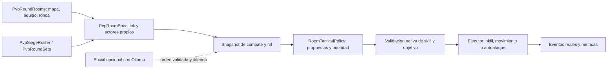

# Adaptacion de cerebros de bots a HELLGAMES Mobius Interlude

Continuacion completada:el ejecutor tactico se integro y activo tras comparaciones y pruebas nativas. Estado vigente en [RESULTADOS.md](../pvp-tactical-engine/RESULTADOS.md). Este documento conserva el analisis y el prototipo de la etapa anterior; sus referencias a "no activo" describen ese momento.

15/10/2026. Resultado de la etapa solicitada: analisis estatico de los tres snapshots completos, catalogo verificable de habilidades y prototipo de decisiones compilado contra nuestro core. **No es una integracion activa ni una certificacion de cada clase en combate.**

## 1. Alcance y evidencia

Se inventariaron236archivos versionados:234textos y2binarios. Se escanearon las160fuentes Java/Kotlin y se revisaron semanticamente los caminos de combate, soporte, mascotas, tareas, ciclo de vida, persistencia, controles y LLM. Los HTML, configuraciones, SQL y utilidades estan inventariados; el inventario automatico no equivale a una auditoria manual exhaustiva de cada linea ni a ejecutar todos sus casos. Los dos binarios son assets, no fueron ejecutados.

| Snapshot | Archivos | Fuentes | Commit |
|---|---:|---:|---|
| L2Autobots |169|110|f990c61df25e94c08ea6c36c5e230928a36ce0fc|
| L2jRoboto |48|40|9ebda43140ceafe7339c2f446fcf054789a5a308|
| l2-smartbot |19|10|f65cb3acc526ffc8f29a76a492ad109375895d39|

`file-inventory.json/csv`:ruta, categoria, SHA256, lineas/imports/tipos de cada archivo. `static-findings.json`:lugares con mutaciones de recursos/inventario, revive/teleport, accesoDB, concurrencia, supuestos de clan/party, HTTP y TODO; son localizadores de revision, no un listado de fallos demostrados. `analyze.py` regenera los resultados sin ejecutar codigo de terceros.

`class-catalog.json`:36perfiles Kotlin (24avanzados y12previos),212referencias a BotSkill, simbolos resueltos contra las constantes y XML local con nombre, target, operacion y efectos. Todos esos IDs existen en nuestro datapack; hay repeticiones entre clases. Esto NO verifica niveles aprendidos, poder numerico, condiciones, equipo o comportamiento runtime.

`cross-engine-skills.json` y `cross-engine-validation.json` agregan106referencias numericas de constructores de skills de L2jRoboto y arrays SKILLS de SmartBot:todos esos IDs tambien existen localmente. Son318referencias verificadas en total, con repetidos; no318habilidades unicas. `PERFILES.md` muestra los nombres locales por perfil. Esta extraccion no descubre IDs calculados dinamicamente.

## 2. Que tomar de cada motor

| Componente | L2Autobots | L2jRoboto | SmartBot | Decision para HELLGAMES |
|---|---|---|---|---|
| Decisiones |CombatBehavior y reglas por clase|Separacion ataque/soporte/curacion y prioridad|Controlador por rol|Politica propia en Java con prioridades explicitas y condiciones por accion|
| Clases |24perfiles avanzados, cobertura desigual|Perfiles Java mas simples|6roles/presets generales|Rol asignado + arma + habilidades realmente disponibles; no asumir que isMageClass basta|
| Curacion |Selecciones de aliado/HP con defectos identificados|Tipos de healing y umbrales|Objetivo herido, seguimiento y resurreccion|HP del destinatario, legalidad de equipo/instancia, recursos y revive solicitado|
| Ataque |Debuffs, blows, cargas y defensas condicionales|Prioridades declarativas|Listas fijas por rol|Listas revisadas/ordenadas, condiciones nativas y cooldown de reintentos|
| Posicion |Kiter, alcance y geodata|Movimiento basico/walkers|Follow/assist|Movimiento nativo limitado al mapa, kite validado; nada de teleport para simular tactica|
| Summons |PetOwner, shots y condiciones de invocacion|Apoyo mas limitado|No es el aporte principal|Separar summon normal/cadaver/cubic y roles; native summon AI y TP si corresponde|
| Recursos |Reposicion y opcion SecretManaRegen|Reabastecimiento automatico|Shots y presets|Conservar stock por vida y handlers nativos actuales; no importar MP directo ni invulnerabilidad|
| Persistencia |DAO propio/autobots|Manager de fake players|DAO de bots persistentes|Conservar roster/tandas actuales; disenar journal de reservas como mejora independiente|
| Operacion |Dashboard/inspeccion/preferencias|Comandos simples|Follow/assist/buff/stop|Extender `.salas bots estado` con rol/accion/fallo; GM y alcance de sala explicitos|
| Social |Chat/tiendas/secuencias|Walkers urbanos|Ollama, memoria corta, hechos por tags|Solo capa social opcional futura, fuera del tick de combate|
| Votaciones |No resuelve nuestro contrato|No resuelve nuestro contrato|No resuelve nuestro contrato|Mantener votacion/tandas existentes; el cerebro no escribe ganador ni tally|

No se toma literalmente ningun constructor de Player, SQL de registro, parche de core, regla de clan ni ciclo de revivir de terceros. Nuestra integracion puede operar sobre el Player ya reservado y las APIs que ya estan verificadas.

## 3. Hallazgos concretos que cambian la adaptacion

### L2Autobots

- `utils/AutobotHelpers.kt` asigna comportamientos por ClassId y falla con clase no implementada. La cobertura no es todas las clases de Interlude. Dominator tiene una sola skill ofensiva1245; SwordMuse/SpectralDancer no implementan una rotacion completa de canciones/danzas. Existen archivos por clase sin que eso implique tactica completa.
- `CardinalBehavior.kt`:condiciones de1218/1217 usan HP del caster en lugar del objetivo. `Healer.kt` tiene TODO de comportamiento defectuoso. Tomar seleccion de aliado y corregir el dato, no copiar esas condiciones.
- `SecretManaRegen.kt`:si MP<20%, lleva MP a maximo. Excluir. ConsumableUser/RequiresMiscItem/PetOwner tambien pueden reponer objetos durante la pelea; mantener nuestra entrega por vida en su lugar.
- `CombatBehavior.kt`:clan y party como amistades y reaparicion/teleport propios. En libre/arena pueden ser adversarios; en equipos manda RoomCombatRules. Respawn corresponde al controlador de la sala.
- `Kiter.kt`:desplazamiento simple por signos X/Y y Z+50. Idea util, destino no portable literalmente a nuestras pendientes/perimetros. Validar altura, margen, colision, distancia ganada y llegada sin reiniciar MOVE_TO continuamente.
- `AdventurerBehavior.kt` exige estar detras para Backstab, pero esa comprobacion no implementa una maniobra para ponerse detras. Distinguir condicion y comportamiento posicional.
- `PetOwner.kt` depende del target actual para la invocacion que requiere cadaver. Nuestro intento generico actual sobre self no cubre ese caso. No forzar summon anulando requisitos.
- `Autobot.kt` usa isBusyThinking; su lectura/escritura separadas no son un compareAndSet. No importar ese scheduler; nuestros ticks por host estan serializados. `CoScopes.kt` declara que necesita rehacerse.
- `AutobotsManager.kt` contiene un filtro de shout que compara la region del bot consigo misma, en lugar de bot con emisor. No portar ese enrutamiento.
- `SocialBehavior.kt` acepta trades y puede iniciar teleports/secuencias urbanas. Fuera del objetivo de salas.
- `patch.diff` engancha Player, AI, idfactory, clan, movement, attack, magic, chat, bypass y entrada. Es un cambio transversal de aCis, no un plugin para Mobius. No aplicarlo.

### L2jRoboto

- `model/BotSkill.java`:constructor de4argumentos recibe priority pero no asigna `_priority`. Las comparaciones por prioridad no obtienen el valor solicitado. Nuestra politica tiene prioridad inmutable y prueba de orden efectivo.
- `ai/CombatAI.java`:calcula shots por nivel; un nivel80 con otra arma requiere el grado real. Mantener el adaptador de shots actual.
- Combate y recursos se apoyan en FakePlayer propio; la clase no es necesaria para decidir acciones sobre nuestros Player.
- `AITask` divide una lista mutable por indices y usa busyThinking. No copiar ese mecanismo a nuestras tandas que cambian al final de ronda.
- Walkers urbanos y randomizacion de apariencia no mejoran el PvP; conservar como referencias opcionales.
- Proyecto archivado/WIP:util para modelos pequenos, no fuente de garantia operativa.

### SmartBot

- `SmartBotController` prioriza cura y resurreccion del rol healer y revisa buffs faltantes. Es el aporte mas util al soporte de equipo. Su candidato usa HP del destinatario, no del healer.
- `handleMageBehavior` puede caer en comportamiento fisico si no encuentra un nuke. No importar ese fallback; conservar nuestra correccion.
- IDs/clases/presets estan ajustados a C4. No instalar equipo ni otorgar skills desde esos presets sobre nuestros personajes hibridos.
- `BotLlmService` interpreta comandos y genera respuestas con Ollama. La decision por habilidad esta en SmartBotController, no en el modelo. Conocimiento por tags y memoria acotada son reutilizables como concepto.
- HttpClient tiene timeout2s de conexion y las peticiones de generacion usan8s. No puede estar dentro del tick500ms ni bloquear el monitor de sala. La cola social futura debe ser acotada, con descarte de contexto de ronda vencida y fallback si el modelo no responde.
- BotMemory usa ArrayDeque sin sincronizacion propia; proteger por actor si varias tareas sociales pueden acceder simultaneamente.
- DAO guarda posicion/estado de bots propios. Eso no restaura nuestros snapshots originales tras un crash: no confundir persistencia de bot con recuperacion de prestamo.

## 4. Encaje exacto en el servidor actual

| Punto actual | Adaptacion propuesta | Se conserva |
|---|---|---|
|PvpRoomBots.tick|Construir snapshot por bot, elegir accion, ejecutar una accion aceptada; separar supervivencia de presencia de enemigo|500ms, pertenencia, bots propios, votos y10srespawn|
|PvpSiegeBrain.act|Delegar politica de rol; estado de casteo/movimiento con tiempos monotonic; no duplicar scheduler|Intenciones nativas y antireinicio de acciones|
|PvpSiegeBrain.target|Puntuar solo candidatos legales y vivos; mantener compromiso de objetivo breve y no cambiar cada tick|Ningun jugador real elegido como blanco automatico en estas pruebas|
|PvpSiegeCombat|Potas/shots actuales; invocacion segun targetType, cadaver valido, TP y pet skills|Handlers, consumo, reuse y contadores ejecutados|
|PvpRoundSets|Asignar rol a cada actor al activar tanda y limpiar memoria tactica al retirarlo|Reserva unica, party de bots, cambio de ronda y fallback|
|PvpRoundRooms / RoomCombatRules|Contexto de instancia, equipos y mapa; no decidir amistades por clan|Parties humanas intactas, autoFlag, votos y salida vulnerable|
|Observabilidad|Rol, ultimo motivo, intento aceptado, evento ejecutado y efecto relevante|Telemetria existente; sin escrituras DB por cada propuesta descartada|

Puentes API: `net.sf.l2j...L2Skill` -> `mechanics.skill.Skill`; Player/L2PcInstance -> `entity.actor.Player`; getSkill -> getKnownSkill; IntentionType/CtrlIntention -> `ai.Intention`; GeoEngine del core local; ThreadPoolManager/coroutines -> tick de sala + workers acotados solo para tareas lentas. No anadir Kotlin, Gradle, servidor Ollama o dependencias de los motores al GameServer para esta primera adaptacion.

El ejecutor debe comprobar de nuevo, justo antes de actuar:reserva vigente, instancia/equipo/generacion, vivo/no teleport/no control, skill conocida, arma/cargas, MP inicial+consumo, HP, materiales, cooldown, rango/LOS, targetType y skill.checkCondition. `useMagic` aceptado se mide separado de ON_CREATURE_SKILL_USE; comprobar efecto/aplicacion cuando se mida eficacia.

## 5. Perfiles y decisiones para Interlude

| Rol | Reglas utiles | Casos que requieren prueba especifica |
|---|---|---|
|Healer|Cura por HP del destinatario; emergencia propia; revive solo aliado muerto sin solicitud pendiente; posicion de apoyo|Cleanse, range, prioridad entre curar/revivir, rechazo revive, habilidades de area|
|Buffer|Detectar buffs propios/aliados faltantes, elegir fisico/magico|Overlord/clan scopes nativos no deben ampliarse artificialmente al equipo|
|Mage|Debuff pertinente y no repetido; nukes segun class/skill; evitar autoataque fisico|Resistencias, Silence sobre objetivo pertinente, consumoHP de toggles|
|Archer|Stun si falta, shot y flechas por arma, kite con histeresis|No salir por la franja ni romper LOS contra una pared|
|Dagger|Bluff/Trick/Switch segun estados; Backstab solo posicion valida; defensa por HP|Buscar espalda sin orbitar indefinidamente ni teletransportarse|
|Tank|Stun/root si no existe, defensa y cura conocidas con umbral|Aggro sobre jugadores, UD que inmoviliza, shield/equipment conditions|
|Summoner|Summon especifico y target correcto; TP si servitor; skills del pet|Cadaveres, cubics, shots de summon, slot unico y limpieza por instancia|
|Warrior|Cargas/arma/HP gobiernan ataques y defensas|Gladiator/Tyrant cargas, Titan HP, WarlordAoE y cercania|
|Support|Canciones/danzas pertinentes y control cercano|Coste de mantenimiento, limites de buff y AoE nativa|

Nuestros personajes son hibridos y conocen habilidades de subclases. Se propone rol persistente para la tanda basado en clase activa y arma, con habilidades disponibles de apoyo como capacidades; no hacer que todos sean healer+summoner+tanque por conocer IDs. El prototipo ya resuelve rol con esa preferencia; la ponderacion individual final requiere ensayos. No se cambia la build para hacerla encajar con un preset externo.

En FFA/arena el prototipo considera a otros participantes oponentes segun RoomCombatRules, incluso si comparten party. En modos por equipo cura solo aliados legales. Una futura opcion de soporte entre parties en FFA debe decidirse expresamente si se desea; no inferir amistad de clan como hacia el motor externo.

## 6. Prototipo entregado y validacion

`adapter-src/custom/ElvenPvpRoom/RoomTacticalPolicy.java`:politica pura con9roles, acciones tipadas, prioridad y urgencia, filtros de permisos/recursos/estado, veto de fallbackfisico para casters y calculo de retiro con margen de64unidades.

`MobiusTacticalPreview.java`:adaptador candidato que compila con GameServer.jar y las clases actuales de salas. Inspecciona skills conocidas, recursos/reuse, rango/LOS, objetivo, efecto faltante y reglas de equipo. Propone curas/defensas/buffs/controles/ataques. **Solo preview**:no llama useMagic, no cambia target, inventario, posicion, parties ni DB.

La previsualizacion deja la condicion nativa final como pendiente del ejecutor (el campo nativeAllowed se entrega true en este candidato); por ello una Decision NO es una autorizacion ni una garantia de casteo. La politica pura acepta ese campo para que el ejecutor pueda reevaluarlo. Tampoco hay ejecucion de movimiento, charges, corpse summon, cubics, AoE, dances, cleanse ni cola social en este prototipo. Estas limitaciones son explicitas, no funcionalidades completadas.

`policy-verification.txt`:30escenarios aprobados:prioridad de supervivencia/curas, seleccion por urgencia, rechazo de skill desconocida/bloqueada/sin recursos/condicion nativa falsa, instancia incorrecta, target ilegal, falta de rango/LOS, dead/busy, revive de vivo/pendiente, fallbackfisico de casters, roles hibridos, retiro dentro del perimetro.

La compilacion prueba compatibilidad de tipos/metodos usados, no la integracion funcional con el combate. No se ejecuto el prototipo sobre el encuentro ni se reemplazo el brain actual. El corpus de terceros tampoco se compilo/ejecuto:depende de cores distintos. `runtime-integrity.json` valida los55hashes de la cadena actual de salas, que no fue modificada en esta etapa.

## 7. Secuencia de integracion y criterios para cerrar

1. **Completado en esta etapa:**inventario, hallazgos por subsistema, catalogo212IDs, API mapping, politica/preview compilados y30escenarios. Referencias de origen y versiones registradas.
2. Ejecutar preview con snapshots de un fixture aislado (no reemplazar ScriptManager del lobby). Evaluar objetivo/rol/accion sin actuacion; asegurar que jugadores reales no aparezcan como blancos y que no haya propuestas cruzadas por instancia.
3. Anadir ejecutor nativo con revalidacion, throttle de reintentos y estado por actor/generacion. Probar primero healer, mago, arquero y tanque en fixture de equipos y FFA. Comparar eventos reales y resultado de acciones, sin forzar el cierre de la ronda del usuario.
4. Incorporar movimiento tactico y pruebas en Elven, Primeval y Saints:LOS, atascos, perimetro, franja y ausencia de teleports correctores como tactica. Luego dagger/cargas/summon/cubic/dances/AoE.
5. Activar por bandera configurable y rol, manteniendo fallback al brain probado. Limpiar contexto de tactica/listeners al retirar/cambiar tanda. Probar votos, retiro normal, restauracion de inventario, parties humanas y registro de lobby.
6. Medir coste de tick con6/12bots por sala y combinacion de4salas; poolDB/telemetria ya dieron saturacion en otra etapa. No anadir consultas ni LLM en cada tick. No prometer capacidad antes de medir.
7. Social opcional al final:conocimiento local y memoria limitada por actor, modelo fuera del combate, ordenes con rol/permisos y contexto vigente. No obligatorio para la mejora tactica.

El rollback futuro es desactivar el ejecutor por rol y volver al brain actual; no migrar SQL ni personajes para probarlo. El journal persistente de reservas y bots derivados independientes (dos Noctis) siguen siendo trabajos separados:ninguno de los tres motores se puede importar para resolverlos automaticamente.

## Referencias y licencias

- L2Autobots:https://github.com/Elfocrash/L2Autobots — LICENSE GPL-3.0 en snapshot.
- L2jRoboto:https://github.com/Elfocrash/L2jRoboto — LICENSE MIT en snapshot.
- SmartBot:https://github.com/PlayerExplains/l2-smartbot — LICENSE GPL-3.0 en snapshot.

Se conservaron repos y LICENSE sin modificar. El prototipo es implementacion propia de decisiones/datos de juego; no incorpora el runtime Kotlin ni copia metodos de los motores. Si en la integracion se traslada codigo de terceros, mantener atribucion/licencia del archivo y revisar distribucion del resultado antes de publicarlo.
